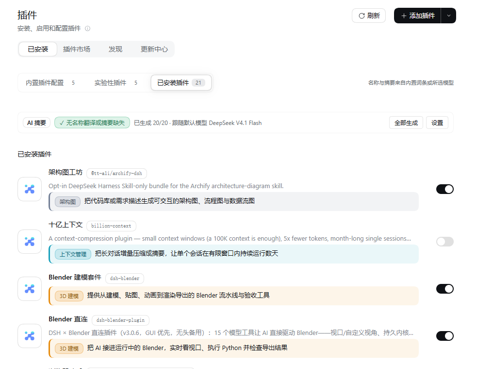

# dsh-plugin-manager-plus · Plugin Manager Plus

[中文](README.md) · English

Reshapes the rendering of the **Installed** tab on DSH Web's official *Plugins* page in place — no extra tab, no replacement of the official page logic:

1. **One group at a time**: the official page's three groups (Built-in plugin config / Experimental plugins / Installed plugins) are shown one at a time, switched with a segmented control injected above the list. The default is *Installed plugins*, and the choice is remembered in `localStorage`.
   - The number beside each group title is that group's item count.
   - The switcher reappears when you come back from a plugin detail page or the *More* page.
2. **Chinese purpose summaries**: every installed-plugin card gets a Chinese summary under its original description, with a colored category tag on the left, a matching tinted background and a left color bar.
3. **Name translation**: English names are replaced by Chinese names in the card title (the official DOM text node is never moved — the original is hidden and a Chinese span appended), while the original English name / package name stays visible in an oval tag on the right. Clicking the title still opens the official plugin detail page.



## Install

Ask the agent to call `plugin_manager`'s `install_bundle` with the target pointing at this directory or at a packed tarball:

```text
target: D:\DSH-workspace\dsh-plugin-manager-plus
target: D:\DSH-workspace\dsh-plugin-manager-plus\dist\dsh-plugin-manager-plus-0.2.0.tgz
```

If the page is already open after install/update, reload it once so the browser loads the new client bundle.

## Pack

```bash
npm run build                 # regenerate client.js
npm pack --pack-destination dist
# produces dist/dsh-plugin-manager-plus-0.2.0.tgz, usable as install_bundle's target
```

`npm pack` runs `prepack` first and rebuilds `client.js`; the tarball contains only what the runtime needs:
`package.json`, `index.js`, `client.js`, `cordis.patch.yml`, `locale/*.json`, `icon.svg`,
`README.md` and `LICENSE`. To ship the sources too, build an extra zip with `src/`, `scripts/`,
`tests/`, `content.zh.json` and `docs/` (see `*-source.zip` under `dist/`).

## Development

```bash
node scripts/build.mjs     # src/client.template.js + content.zh.json + locale/*.json -> client.js
node --check client.js     # syntax check
node tests/model.test.mjs  # offline data / translation / summary / manifest checks
```

- `content.zh.json`: Chinese names, summaries, category tags and tones for installed plugins; a plugin with no entry falls back to vocabulary translation plus a generic summary.
- `locale/zh.json`, `locale/en.json`: plugin metadata (`meta`) and strings for the injected controls.
- `src/client.template.js`: the browser-side source; `client.js` is a build artifact — do not edit it directly.

## How it works

- The official Plugins page is React-rendered. This plugin only *appends*: it adds its own nodes, sets classes/attributes or `display` on host nodes, and **never moves or removes host nodes**. A `MutationObserver` re-applies everything idempotently after the host re-renders, and the plugin cleans up completely when disabled.
- Selectors rely only on the official page's automation hooks: `[data-plugin-panel]`, `[data-plugin-body]`, `[data-plugin-group="basic|extensions|bundles"]` and `li[data-plugin-package]`.
- No Harness Client package is imported and the official enable/install/uninstall logic is left untouched; styling uses only `--dsw-alias-*` theme tokens plus a little hue mixing, so it follows light and dark themes.
- Names and summaries are never written into the official page's React state, so official data, ordering and toggles keep behaving exactly as before.

## License

MIT License, Copyright (c) 2026 dsh-plugin-manager-plus contributors.

Free to use, modify and redistribute under the MIT license; see [LICENSE](LICENSE) for the full text.
